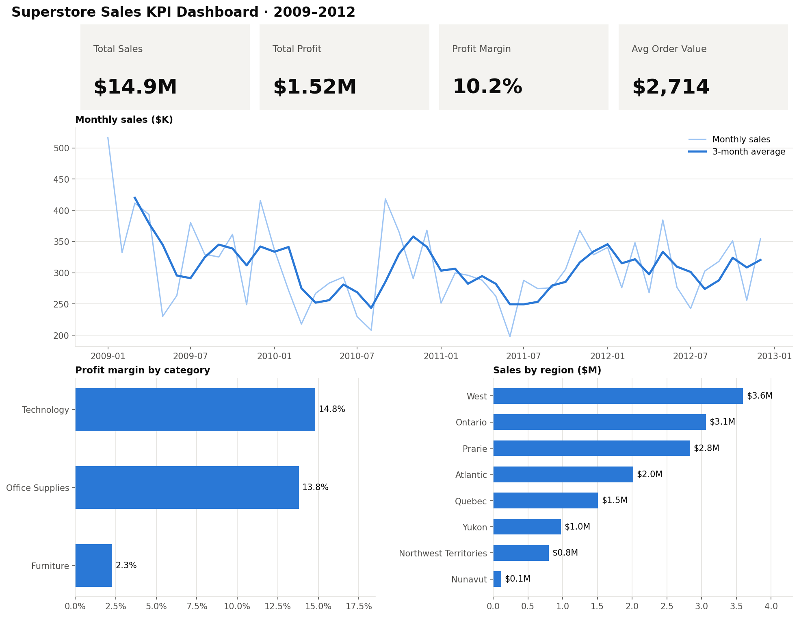

# 📊 Retail Sales KPI Dashboard with Pandas

A data analysis project ([view the notebook](notebooks/kpi_dashboard.ipynb)) that turns **8,399 raw retail order lines** (Superstore, Canada, 2009–2012) into a
one-page **KPI dashboard** using Python, Pandas and Matplotlib.



## 🔍 Key findings

| KPI | Value |
|---|---|
| Total sales | **$14.9M** |
| Total profit | **$1.52M** |
| Profit margin | **10.2%** |
| Orders / customers | **5,496 / 795** |
| Average order value | **$2,714** |

- **Furniture is a margin problem:** it brings in about 35% of sales but earns only a **2.3% margin**, compared with ~14–15% for Technology and Office Supplies.
- **About half of all order lines (51%) lose money**, so profit depends on a small set of high-margin sales.
- **West, Ontario and the Prairies** account for over 60% of sales.
- Sales fell in 2010 (−16%) and 2011 (−3%), then **recovered by +8% in 2012**.
- **Low-priority orders take ~4.2 days to ship**, compared with ~1.5 days for every other priority.

## 🧠 What this project covers

| Step | Pandas skills |
|---|---|
| Load | `read_csv` with a non-UTF-8 encoding |
| Explore | `shape`, `info`, `describe`, and the "rows ≠ orders" trap |
| Clean | group-wise missing value filling (`groupby().transform`), `to_datetime`, categories |
| KPI columns | date arithmetic, boolean flags, `.dt` accessors |
| Aggregate | named aggregation (`agg`), `nunique`, `pivot_table` |
| Time KPIs | monthly totals, year-over-year growth (`pct_change`), rolling averages |
| Visualize | multi-panel dashboard with `subplot_mosaic` |
| Reuse | an empty-safe `kpi_report()` function applied to every region |

## 📁 Project structure

```
retail-kpi-dashboard/
├── data/superstore_sales.csv              # raw dataset
├── notebooks/kpi_dashboard.ipynb           # full analysis (start here)
├── notebooks/kpi_dashboard_exercises.ipynb # blank practice version with hints and checks
├── images/kpi_dashboard.png               # dashboard output
└── requirements.txt
```

## ▶️ How to run

```bash
pip install -r requirements.txt
jupyter notebook notebooks/kpi_dashboard.ipynb
```

## 🚀 Ideas for next steps
- An interactive region filter with `ipywidgets`
- A web version with Streamlit (`st.metric` for the KPI cards)
- Top 10 most profitable customers and the most loss-making products
- Is discounting driving the losses?

## 🙏 Credits

- This project is **inspired by and follows the structure of** the free lesson
  [*Building a KPI Dashboard with Pandas*](https://www.mathewkanalytics.com/lessons/mastering-pandas/058-building-a-kpi-dashboard-with-pandas/)
  by **[Mathew K Analytics](https://www.mathewkanalytics.com/)**
  ([video](https://www.youtube.com/watch?v=lid1q679cs0) · [YouTube channel](https://www.youtube.com/@KarMat-Analytics)).
  The original uses the Titanic dataset. This version applies the same workflow to retail sales data and extends it with real time-series KPIs,
  group-wise cleaning, a multi-panel dashboard and a reusable report function.
- Dataset: *Superstore Sales* sample data, from [curran/data](https://github.com/curran/data/tree/gh-pages/superstoreSales).
